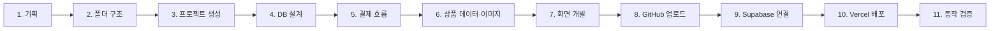
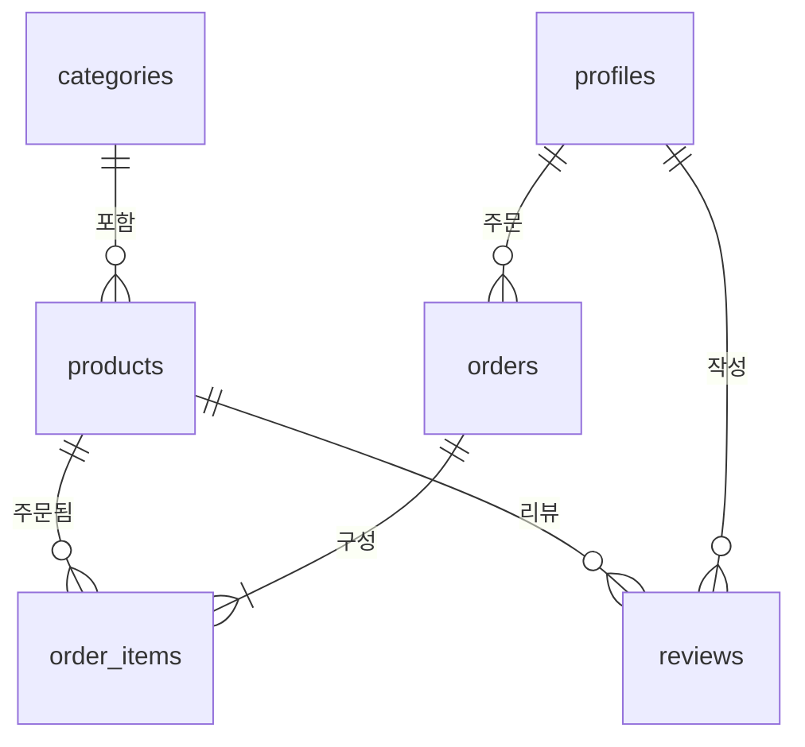
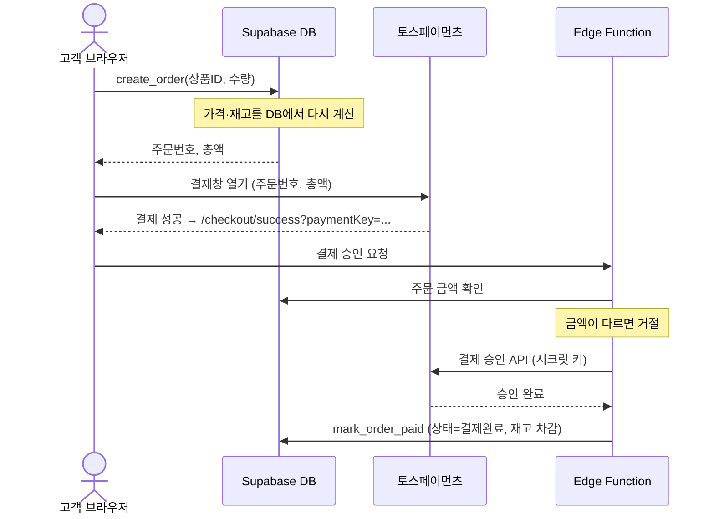

# 📘 아두몰 만들기 — 단계별 학습 가이드

> 아두이노 쇼핑몰을 **기획 → 개발 → 배포**까지 하루 동안 진행한 과정을 정리한 문서입니다.
> 각 단계마다 **무엇을 했는지 / 왜 그렇게 했는지 / 직접 해볼 것**을 담았어요.

---

## 🗺️ 전체 흐름



| 단계 | 핵심 키워드 | 결과물 |
|---|---|---|
| 1~2 | 요구사항, 기술 스택 | `docs/PLAN.md`, 폴더 구조 |
| 3 | create-next-app | Next.js 프로젝트 |
| 4~5 | 테이블, RLS, DB 함수, Edge Function | `supabase/migrations`, `supabase/functions` |
| 6 | 시드 데이터, 이미지 라이선스 | `supabase/seed`, `public/images` |
| 7 | 서버 컴포넌트, 서버 액션 | `src/` 전체 |
| 8~10 | Git, Vercel, 환경변수 | 배포 URL |
| 11 | 통합 테스트 | 보안·결제 흐름 확인 |

---

## 1단계. 기획하기

코드를 쓰기 전에 **무엇을 만들지**부터 정했습니다.

**누가 쓰나요?**
- 👤 고객: 상품 보기, 장바구니, 결제, 리뷰
- 🛠️ 관리자: 상품 등록, 재고·주문 관리

**기술 스택 선택 이유**

| 선택 | 이유 |
|---|---|
| Next.js | 화면 + 서버 코드를 한 프로젝트에서 작성 가능 |
| Supabase | DB·로그인·파일 저장을 직접 서버 없이 사용 |
| Tailwind CSS | CSS 파일 없이 클래스만으로 빠르게 디자인 |
| 토스페이먼츠 | 국내 결제, 공개 테스트 키 제공 |
| Vercel | GitHub 저장소만 있으면 클릭 몇 번으로 배포 |

> ✏️ **직접 해보기:** 내가 만들고 싶은 쇼핑몰의 "고객 기능 5개, 관리자 기능 3개"를 적어보세요.

---

## 2단계. 폴더 구조 잡기

Next.js App Router는 **폴더 이름이 곧 URL**입니다.

```
src/app/(shop)/products/[slug]/page.tsx  →  /products/arduino-uno-r3
```

| 문법 | 의미 | 예시 |
|---|---|---|
| `폴더/page.tsx` | 해당 URL의 화면 | `cart/page.tsx` → `/cart` |
| `[slug]` | 변하는 값 (동적 경로) | `/products/sg90` |
| `(shop)` | URL에 안 나오는 그룹 | 파일 정리용 |
| `route.ts` | 화면 대신 API | `auth/callback/route.ts` |

---

## 3단계. 프로젝트 생성

```bash
npx create-next-app@15 arduino-shop --ts --tailwind --eslint --app --src-dir
npm install @supabase/ssr @supabase/supabase-js zustand @tosspayments/tosspayments-sdk
```

| 패키지 | 역할 |
|---|---|
| `@supabase/ssr` | 쿠키로 로그인 상태를 서버와 공유 |
| `zustand` | 장바구니 상태 관리 (새로고침해도 유지) |
| `@tosspayments/tosspayments-sdk` | 결제창 띄우기 |

---

## 4단계. 데이터베이스 설계

📄 파일: `supabase/migrations/0001_init.sql`

### 테이블 관계



| 테이블 | 저장하는 것 |
|---|---|
| `profiles` | 회원 이름·연락처·주소·권한(user/admin) |
| `categories` | 개발보드, 센서, 모듈, 부품, 키트, 공구 |
| `products` | 상품명, 가격, 재고, 사양(JSON), 이미지 |
| `orders` | 주문번호, 상태, 총액, 배송지 |
| `order_items` | 주문 당시 상품명·가격·수량 (가격이 바뀌어도 기록 유지) |
| `reviews` | 별점, 내용 |

### 🔐 RLS (Row Level Security) — 가장 중요한 개념!

Supabase는 브라우저가 DB에 **직접** 접근합니다. 그래서 "누가 어떤 행을 볼 수 있는지"를 DB에 규칙으로 정해 둡니다.

```sql
-- 내 주문만 볼 수 있다 (관리자는 전체)
create policy "orders_select" on public.orders for select to authenticated
  using (user_id = (select auth.uid()) or (select public.is_admin()));
```

| 테이블 | 읽기 | 쓰기 |
|---|---|---|
| 상품·카테고리 | 누구나 | 관리자만 |
| 주문 | 본인 + 관리자 | DB 함수로만 생성 |
| 리뷰 | 누구나 | 구매한 사람만 |
| 프로필 | 본인 + 관리자 | 본인 (단, `role` 컬럼은 불가) |

> ⚠️ **RLS를 켜지 않으면** 누구나 모든 데이터를 읽고 지울 수 있어요!

---

## 5단계. 주문·결제 흐름 설계

**핵심 원칙: 브라우저가 보낸 금액은 절대 믿지 않는다.**



| 구성요소 | 위치 | 하는 일 |
|---|---|---|
| `create_order` | DB 함수 | 가격을 서버에서 계산해 주문 생성 |
| `confirm-payment` | Edge Function | 금액 검증 → 토스 승인 → 결제완료 처리 |
| `mark_order_paid` | DB 함수 | Edge Function만 호출 가능 (일반 사용자 차단) |

> 💡 **왜 Edge Function인가요?** 토스 **시크릿 키**와 Supabase **서비스 키**는 브라우저에 절대 노출되면 안 됩니다. Edge Function은 Supabase 서버에서 실행되므로 안전하게 보관할 수 있어요.

---

## 6단계. 상품 데이터와 이미지

### 상품 데이터
- 디바이스마트에서 22개 상품의 **부가세 포함 판매가**를 조사
- `supabase/seed/products.json`에 저장 → 스크립트로 SQL 생성

```bash
node supabase/seed/build-seed.mjs   # products.json → seed.sql
```

> 💡 데이터(JSON)와 SQL을 분리하면, 상품을 추가할 때 JSON만 고치면 됩니다.

### 이미지 — 저작권 지키기
- 도형/그림 대신 **실제 사진** 사용
- Wikimedia Commons, Flickr의 **CC 라이선스** 사진만 선택
- CC BY / CC BY-SA는 **출처 표기 의무** → `/credits` 페이지와 `public/images/CREDITS.md`에 기록

| 라이선스 | 의미 |
|---|---|
| CC0 / PD | 자유 사용, 표기 불필요 |
| CC BY | 저작자 표기하면 자유 사용 |
| CC BY-SA | 저작자 표기 + 같은 라이선스 유지 |

---

## 7단계. 화면 개발

### 서버 컴포넌트 vs 클라이언트 컴포넌트

| 구분 | 서버 컴포넌트 (기본) | 클라이언트 컴포넌트 |
|---|---|---|
| 선언 | 아무것도 안 씀 | 파일 맨 위 `"use client"` |
| 실행 위치 | 서버 | 브라우저 |
| 잘하는 일 | DB 조회, 비밀 값 사용 | 클릭, 입력, 상태 변경 |
| 예시 | 상품 목록, 상품 상세 | 장바구니, 수량 버튼, 결제 폼 |

### 서버 액션 — 폼을 서버 함수로 바로 연결

```tsx
// lib/actions/profile.ts
"use server";
export async function updateProfile(_, formData: FormData) { /* DB 업데이트 */ }

// 컴포넌트
const [state, action, pending] = useActionState(updateProfile, null);
<form action={action}>...</form>
```

### 미들웨어 — 로그인 필요한 페이지 보호
`src/middleware.ts`가 `/mypage`, `/checkout`, `/admin` 접근 시 로그인 여부를 확인하고, 아니면 `/login?next=...`로 보냅니다.

---

## 8단계. GitHub에 올리기

```bash
git init -b main
git add -A
git commit -m "Arduino shop 첫 커밋"
gh repo create arduino-shop --private --source=. --remote=origin --push
```

> ⚠️ **올리면 안 되는 파일:** `.env.local`(비밀 키), `node_modules`, `.vercel`
> → `.gitignore`에 등록되어 있는지 커밋 전에 꼭 확인하세요. (`git status`로 확인)

---

## 9단계. Supabase 프로젝트 연결

1. supabase.com에서 **조직(Organization) 생성** → Free 플랜
2. **프로젝트 생성** → DB 비밀번호는 "Generate a password" 사용
3. **액세스 토큰 생성** (Account → Access Tokens)
   - 범위: 이 프로젝트만 / 만료: 7일 → 최소 권한 원칙
4. CLI 로그인 후 작업
   ```bash
   npx supabase login --token <토큰>
   npx supabase functions deploy confirm-payment --project-ref <ref> --use-api
   ```
5. SQL 실행 (SQL Editor 또는 Management API)
6. **Auth 설정**: Site URL과 Redirect URL에 배포 주소 등록

---

## 10단계. Vercel 배포

```bash
npm install -g vercel
vercel login                         # 별도 터미널에서
vercel link --yes --project arduino-shop
vercel env add NEXT_PUBLIC_SUPABASE_URL production
vercel deploy --prod
```

| 환경변수 | 공개해도 되나요? |
|---|---|
| `NEXT_PUBLIC_SUPABASE_URL` | ✅ (브라우저에 노출되는 값) |
| `NEXT_PUBLIC_SUPABASE_ANON_KEY` (publishable) | ✅ RLS가 보호 |
| `NEXT_PUBLIC_TOSS_CLIENT_KEY` | ✅ 클라이언트 키 |
| Supabase **secret / service_role** 키 | ❌ 절대 금지 |
| 토스 **시크릿** 키 | ❌ Edge Function에만 |

> 💡 `NEXT_PUBLIC_` 접두사가 붙은 변수만 브라우저 코드에 포함됩니다.

---

## 11단계. 동작 검증

테스트 계정을 만들어 스크립트로 확인한 결과입니다.

| 테스트 | 기대 결과 | 결과 |
|---|---|---|
| 로그인 | 성공 | ✅ |
| 주문 생성 금액 | 서버 계산값과 일치 (36,080원) | ✅ |
| 결제 금액 조작 | "결제 금액이 주문 금액과 다릅니다" | ✅ 차단 |
| 가짜 결제키 승인 | 토스가 거절, 주문은 결제대기 유지 | ✅ 차단 |
| 스스로 관리자 승격 | 권한 없음 | ✅ 차단 |
| 결제 없이 결제완료 처리 | 권한 없음 | ✅ 차단 |
| 주요 페이지 접속 | HTTP 200 | ✅ |

> ✏️ **직접 해보기:** 배포 사이트에서 회원가입 → 장바구니 → 테스트 결제 → 마이페이지 주문 확인까지 진행해 보세요.

---

## 🧯 트러블슈팅 — 오늘 실제로 겪은 문제들

| 문제 | 원인 | 해결 |
|---|---|---|
| `supabase login` 실패 "non-TTY environments" | 대화형 입력이 안 되는 터미널에서 실행 | 일반 PowerShell 창에서 실행하거나 `--token` 옵션 사용 |
| `export TOKEN=...` 했는데 인식 안 됨 | 환경변수는 **그 터미널 창에서만** 유효 + PowerShell 문법은 `$env:` | `supabase login --token`으로 PC에 저장 |
| 토큰 생성 시 조직 선택 목록이 비어 있음 | Supabase 계정에 조직이 없음 | 조직 → 프로젝트 순서로 먼저 생성 |
| `vercel link` 후 `.env.example`이 Git에서 빠짐 | Vercel이 `.gitignore` 끝에 `.env*`를 추가해 예외 규칙을 덮어씀 | 추가된 줄 삭제 (`.gitignore`는 **아래 줄이 우선**) |
| Vercel ↔ GitHub 연결 실패 | 비공개 저장소에 Vercel GitHub App 권한 없음 | github.com/apps/vercel 에서 저장소 선택 후 설치 |
| `vercel env add`가 값 입력 없이 끝남 | 이름에 `KEY`가 있어 민감값 여부 확인 필요 | `--type config --value "..." --yes` 옵션으로 명시 |
| 회원가입 인증 메일이 안 옴 | Supabase 무료 SMTP는 시간당 발송 제한 | 학습용으로 이메일 자동 확인(autoconfirm) 켬 |

---

## 🎯 연습 과제

**🟢 기초**
1. 새 카테고리 "도서"를 추가하고 상품 1개를 등록해 보세요. (관리자 페이지 이용)
2. 메인 배너 문구를 바꿔 보세요. (`src/app/page.tsx`)

**🟡 중급**
3. 상품 목록에 "리뷰 많은 순" 정렬을 추가해 보세요.
4. 5만 원 미만 주문에 배송비 3,000원을 붙여 보세요. (힌트: `create_order` 함수도 수정해야 금액 조작을 막을 수 있어요!)

**🔴 심화**
5. 결제 취소 기능을 만들어 보세요. (토스 결제 취소 API + 재고 복구)
6. 장바구니를 DB에 저장해 다른 기기에서도 보이게 해 보세요. (`cart_items` 테이블 + RLS)

---

## 📎 참고 링크
- Next.js App Router: https://nextjs.org/docs/app
- Supabase RLS: https://supabase.com/docs/guides/database/postgres/row-level-security
- Supabase Edge Functions: https://supabase.com/docs/guides/functions
- 토스페이먼츠 결제창 연동: https://docs.tosspayments.com/guides/v2/payment-window/integration
- Vercel 환경변수: https://vercel.com/docs/environment-variables
